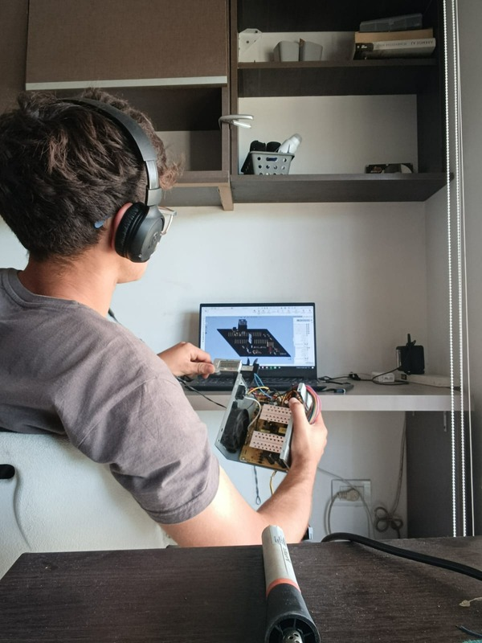

# ⚡​Car Battery Charger + Power Supply🔋​🚗​​
> `ATX PC Supply transformed in a bench supply + car battery charger`

## 📄[Documentation](./documentation) (Hack Club requirements)
Here you will find the main resources and documentation of the project.

#### [⚡📐CAD Case & Electronics design](./documentation/cad)
#### [🧪​🔨​ Demo & prototypes test](./documents/demo)
#### [​📄🧠​Research Fundamentation](./documentation/research)
#### [📋💲Budget BOM (Bill of materials)](./documentation/budget)

## Who's behind & Why

Hello! I am Valentino, an Argentine Electromechanics Technician Student, enthusiastic about Physics and Science. Since this year started I had the idea of recycling an old PC ATX Power supply and build a Lab Supply and a battery charger, because thid devices can hold more than 30 Ampers of current (which is a lot). Now, Holydays started and along this repo you will see all my research from fundamentation of  regulable electronics to my CAD designs.

#
