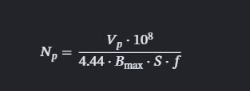
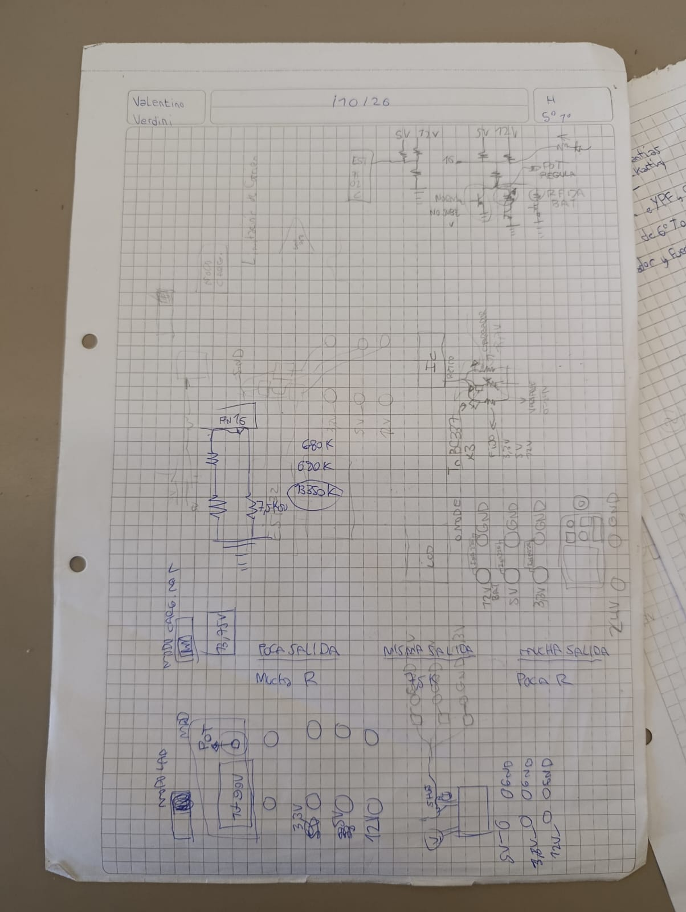

All became of a necessity, or we can say something like a "challenge": Amperage.

Car batteries needs a lot of current to charge. I knew how to make regulable supplies because on of my school projects was that, but with voltage regulator with a current up to 1A max. Just traditional power supplies, with regulators like LM317 or LM7805.
But one day I noticed an old ATX PC Power Supply in my house can supply more than 30 Amps! that blew my mind. I really did not know that such a portable device can hold more than 15Amps without exploding.
There I met the Switching Supplies, and its working.

At school, on the Coiling Workshop, I met this formula:

Which one you can calculate the turns quantity in the primary winding.

Switching supplies are lighter than traditional supplies because of the core. It is smaller. But... to work with small cores, we need to keep that product, increasing another of the elements. That is where frequency comes in scene. Increasing it with electronic components would allow us to make smaller devices due to smaller cores.

So ¿How can we increase the frequency? with electronics. Using commutation Mosfets to increase it from the Electric Network 60 or 50 hz to more than 100 Khz. This high frequency also implies use fast diodes and smaller capacitors.

The only disadvantage of this supplies is the RF interference due to the high frequency.

Now, I know a bit more of how this supplies work, but the real challenge here was the regulation.

The suplies has got an IC (Integrated Circuit), in my chase it is the EST7502C(http://esthome.com/EST.7502C%20Rev1.50.pdf) that manages protections, of/on turning and the important: Output Voltages.
There is a feedback pin which measures all the time the voltage. With respect to ground, that pin should be on 2,45V to have normal output voltages, just as 12V, 3,3V and 5V, But if I put less than that reference, the IC "Thinks" something is wrong, so it increase the output
voltages.

My first thought was to wire a potentiometer following a parallel or series connection to ground. But there I realized:
In a series connection, I increase the equivalent resistance, increasing the voltage drop, finally decreasing the voltages outputs.
But with that potentiometer there, I could not Increase the voltage output.

Then I thought the same would happen in a parallel connection, where I could just increase the output voltage but not decrease it.

So what was the solution? to make flow a current from another voltage of the supply to the Feedback node, controlling it with a potentiometer that also decrease its resistance to "steal" current from the node decreasing its voltage.

Also, another problem I had to deal with was my modes idea: I want 2 modes on the supply, one "Free" without restrictions to select any voltage and another blocked on 14V and 3Amps max, which is the car battery charger. Both modes can not be active at the same time, so I had to implement the ESP32 and transistors, which because of some troubles I changed to a double system with Mosfets and BJT triggered from an ESP 32 GPIO.

All these sheets are my reasoning, exposing arguments of how that could work, applying always the ohm law to try to discover what is happening.

All of these is finished on the Kicad PCB and adapted in the Case, designed on solidworks.

Understanding how this system works carried me lot of time I am not counting, but it was necessary to achieve a complete project.

